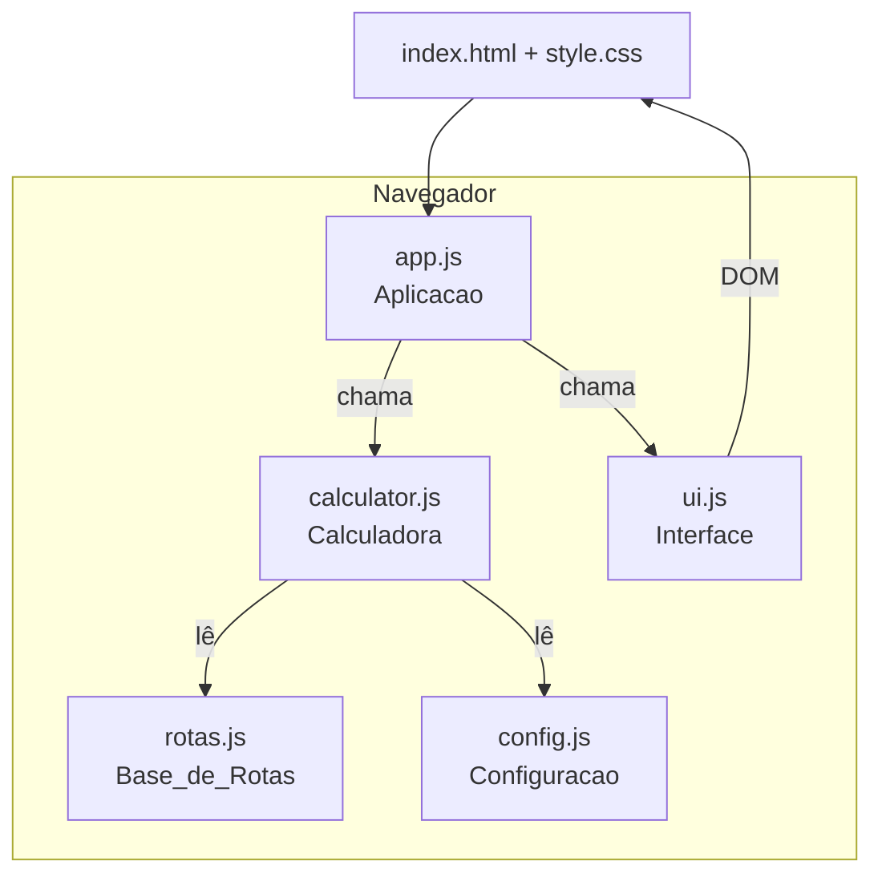
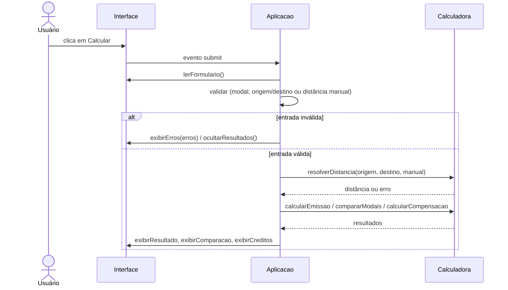
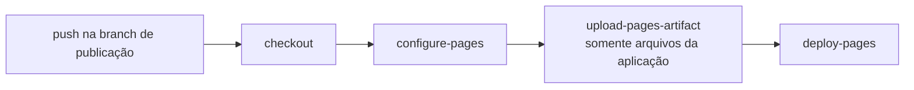

# Documento de Design

## Overview

A EcoTrip é uma aplicação web estática (HTML, CSS e JavaScript puros, sem framework nem biblioteca de terceiros) que calcula a emissão de CO2 de uma viagem, compara quatro modais (bicicleta, carro, ônibus, caminhão) e estima o custo de compensação com créditos de carbono.

Decisões de design principais:

| Decisão | Justificativa |
|---|---|
| Lógica de cálculo isolada na `Calculadora`, sem acesso ao DOM | Permite testar no console e com testes automatizados (Req. 10.3, 10.4). |
| Distância obtida somente por `Calculadora.obterDistancia` (a Funcao_de_Distancia) | A troca futura por API de mapas altera uma única função (Req. 3.5). |
| `Configuracao` validada ao carregar (falha explícita) | Evita cálculos com fatores ou preço inválidos (Req. 9.5). |
| Módulos como objetos globais em `window`, sem ES modules | Funciona abrindo `index.html` direto e atende ao Req. 10.2. O padrão `if (typeof module !== "undefined") module.exports = ...` no final de cada arquivo permite importá-lo em Node nos testes, sem alterar o comportamento no navegador. |
| Funções puras para formatação, filtro de cidades e comparação, dentro da `Calculadora` | A `Interface` fica só com DOM; tudo que tem regra é testável sem navegador. |
| Arredondamento meio para cima por função única | Mesmo comportamento em emissão, créditos e custo (Req. 6.4, 8.3). |

Pesquisa: o deploy usa o fluxo oficial de GitHub Pages com Actions (`actions/configure-pages`, `actions/upload-pages-artifact`, `actions/deploy-pages`), descrito na [documentação do GitHub Pages](https://docs.github.com/en/pages/getting-started-with-github-pages/using-custom-workflows-with-github-pages). Para os testes de propriedade, a biblioteca escolhida é a [fast-check](https://fast-check.dev/), executada com o test runner nativo do Node (`node --test`). Ela fica apenas como dependência de desenvolvimento e não é carregada pelo navegador (Req. 1.5).

## Architecture

### Camadas e dependências



Regras de dependência:

- `Calculadora` lê `Base_de_Rotas` e `Configuracao`. Não referencia `document` nem `window.document`.
- `Interface` só manipula DOM. Não calcula nada.
- `Aplicacao` é o único ponto que conhece as duas: lê entradas pela `Interface`, chama a `Calculadora` e devolve resultados ou erros à `Interface`.

### Ordem de carregamento (Req. 10.5)

```html
<script src="rotas.js"></script>
<script src="config.js"></script>
<script src="calculator.js"></script>
<script src="ui.js"></script>
<script src="app.js"></script>
```

O arquivo da Base_de_Rotas se chama `rotas.js`. Com `index.html` e `style.css`, são exatamente os 7 arquivos do Req. 10.1.

### Estrutura do repositório

```
/
├── index.html
├── style.css
├── rotas.js
├── config.js
├── calculator.js
├── ui.js
├── app.js
├── README.md
├── .gitignore
├── .github/workflows/deploy.yml
└── tests/            (somente desenvolvimento; fora do artefato publicado)
    └── *.test.js
```

Observação: o Req. 10.1 limita os arquivos de script "próprios" da aplicação a 7. Os arquivos em `tests/` são ferramenta de desenvolvimento, não são carregados pela página e o workflow publica somente os 7 arquivos da aplicação. Se o autor considerar que `tests/` viola o requisito, os testes podem ser rodados fora do repositório; essa é uma decisão a confirmar.

### Fluxo do cálculo



## Components and Interfaces

### Base_de_Rotas (`rotas.js`)

Simula o back-end. Define `window.Base_de_Rotas`:

```js
const Base_de_Rotas = {
  cidades: ["Belo Horizonte", "Brasília", "Curitiba", /* ... */],
  distancias: [
    { origem: "São Paulo", destino: "Rio de Janeiro", km: 430.0 },
    // um registro por par; a busca é simétrica
  ],
};
```

- Cada `km` é um número em (0, 10000] com no máximo 1 casa decimal (Req. 3.1).
- Cada par aparece uma só vez; a simetria é tratada na busca, não duplicando dados.
- Nenhuma chave de API no arquivo (Req. 3.6).

### Configuracao (`config.js`)

```js
const Configuracao = {
  // g CO2 por km. Fonte: <nome da fonte>, <ano>
  fatoresEmissao: { bicicleta: 0, carro: 0, onibus: 0, caminhao: 0 },
  // R$ por tonelada de CO2 (1 crédito). Fonte: <nome da fonte>, <ano>
  precoCredito: 0,
};
```

Os valores numéricos são definidos na implementação, cada um com comentário de unidade e fonte (Req. 9.4). A `Configuracao` expõe só dados. A validação fica na `Calculadora` (`validarConfiguracao`), que a executa quando é chamada pela `Aplicacao` na inicialização e antes de cada cálculo.

### Calculadora (`calculator.js`)

Todas as funções são puras e não tocam o DOM. Erros são sinalizados lançando `ErroCalculadora` (subclasse de `Error`) com a propriedade `parametro` que identifica o item inválido (Req. 10.6).

| Função | Assinatura | Comportamento |
|---|---|---|
| `validarConfiguracao` | `(config = Configuracao) → void` | Lança `ErroCalculadora` com `parametro` (ex.: `"fatoresEmissao.carro"`, `"precoCredito"`) se algum fator ausente, não numérico ou negativo, ou se o preço estiver fora de (0, 999999.99] ou tiver mais de 2 casas (Req. 9.1, 9.2, 9.5). |
| `obterDistancia` (Funcao_de_Distancia) | `(origem, destino) → number` | Busca simétrica na `Base_de_Rotas`. Lança `ErroCalculadora` com `codigo: "ROTA_NAO_ENCONTRADA"` se o par não existe (Req. 3.2 a 3.5). |
| `validarDistanciaManual` | `(valor) → number` | Aceita número em (0, 20000]. Lança `ErroCalculadora` com `codigo: "DISTANCIA_INVALIDA"` (vazio, zero, negativo, não numérico) ou `"DISTANCIA_MAXIMA"` (> 20000) (Req. 4.2 a 4.4). |
| `resolverDistancia` | `(origem, destino, manual) → number` | Se `manual` foi informada, valida e usa; senão chama `obterDistancia` (Req. 5.5). |
| `calcularEmissao` | `(distanciaKm, modal) → number` | `distanciaKm * fator[modal] / 1000`, em kg. Valida distância em (0, 20000] e fator definido, numérico e ≥ 0; fator 0 é válido (Req. 6.2, 6.3, 6.6, 6.7). |
| `compararModais` | `(distanciaKm) → ItemComparacao[]` | Calcula os quatro modais, ordena por emissão crescente com ordem original como desempate, calcula `larguraPct` e `diferencaPct` (Req. 7). |
| `calcularCreditos` | `(emissaoKg) → number` | `emissaoKg / 1000`. Lança erro se a emissão for negativa ou não numérica (Req. 8.1, 8.8). |
| `calcularCustoCompensacao` | `(creditos) → number` | `creditos * Configuracao.precoCredito`. Lança erro se o preço for inválido (Req. 8.2, 8.7). |
| `calcularCompensacao` | `(emissaoKg) → {creditos, custo, erroPreco?}` | Combina as duas anteriores. Se o preço for inválido, devolve `creditos` e `erroPreco` em vez de lançar, para a Interface manter os créditos na tela (Req. 8.7). |
| `arredondarMeioParaCima` | `(valor, casas) → number` | `Math.round(Number((valor * 10**casas).toPrecision(15))) / 10**casas`. O `toPrecision(15)` elimina ruído de ponto flutuante (ex.: 1.005 × 100 = 100.49999999999999). Os valores são sempre ≥ 0, então `Math.round` equivale a meio para cima. |
| `formatarNumero` | `(valor, casas, milhar = false) → string` | Formata em pt-BR: vírgula decimal, ponto de milhar quando `milhar` é verdadeiro. Implementação manual, sem depender de `Intl`/locale do ambiente. |
| `formatarEmissao` | `(kg) → string` | `formatarNumero(kg, 2)` (Req. 6.4). |
| `formatarDistancia` | `(km) → string` | `formatarNumero(km, casas, true)`, por exemplo `1.234,5` (Req. 6.4). |
| `formatarCreditos` / `formatarCusto` | `(valor) → string` | 4 casas e 2 casas, respectivamente (Req. 8.3). |
| `normalizarTexto` | `(texto) → string` | Minúsculas e sem acentos (`normalize("NFD")` removendo `\u0300-\u036f`). |
| `filtrarCidades` | `(texto, cidades = Base_de_Rotas.cidades) → string[]` | Retorna `[]` se `texto` tem menos de 2 caracteres; senão até 10 cidades cujo nome normalizado contém o texto normalizado, em ordem alfabética (Req. 2.1, 2.2). |

`ItemComparacao`:

```js
{ modal: "carro", emissaoKg: 12.34, larguraPct: 100, diferencaPct: 25.5 | null }
```

Regras de `compararModais`:

- `larguraPct = max === 0 ? 0 : Math.round(emissaoKg / max * 100)` (Req. 7.3, 7.4).
- `menorNaoZero` é a menor emissão > 0. Para emissão > 0, `diferencaPct = (emissao − menorNaoZero) / menorNaoZero * 100`. Para emissão = 0, `diferencaPct = null` (Req. 7.5, 7.6).
- O resultado inclui o campo `semEmissao: true` quando todas as emissões são 0, e a Interface omite todos os percentuais e exibe a mensagem de "sem emissão a comparar" (Req. 7.7).

### Interface (`ui.js`)

Só manipula DOM. Funções principais:

| Função | Responsabilidade |
|---|---|
| `inicializar()` | Liga o autocomplete aos campos de origem e destino e deixa as três seções de resultado ocultas (atributo `hidden`, que também as retira da árvore de acessibilidade) (Req. 1.2). |
| `lerFormulario()` | Retorna `{origem, destino, distanciaManual, modal}` com os valores crus. |
| `exibirSugestoes(campo, cidades)` / `fecharSugestoes(campo)` | Lista de sugestões com `role="listbox"`; mensagem "Nenhuma cidade encontrada" como item não selecionável (Req. 2.4). |
| `tratarTecladoAutocomplete(evento)` | Setas movem o destaque (`aria-activedescendant`), Enter seleciona, Esc fecha sem alterar o texto (Req. 2.5). |
| `exibirErro(campo, mensagem)` / `limparErro(campo)` | Uma única mensagem por campo, em região `role="alert"` imediatamente após o campo; substitui a anterior em vez de acrescentar (Req. 11.1 a 11.3). |
| `exibirResultado(dados)` | Distância, modal e emissão com rótulo e unidade. |
| `exibirComparacao(itens)` | Lista ordenada com barra (largura em `style.width`) e percentual. |
| `exibirCreditos(dados)` | Créditos, custo, aviso de estimativa com o preço usado, mensagens de emissão zero ou erro. |
| `ocultarResultados()` | Oculta as três seções e remove seu conteúdo (Req. 7.8). |

Detalhes de HTML e CSS:

- `index.html` tem um `header`, um `main` com quatro `section` (formulário, resultado, comparação, créditos) e um `footer` (Req. 1.1).
- Cada campo tem `<label for>` visível. Modais são `input type="radio"` num `fieldset` sem opção marcada (Req. 5.1). A distância manual é `input type="number" step="0.01" min="0"`.
- `style.css` define todas as cores como variáveis em `:root` (`--cor-fundo`, `--cor-texto`, `--cor-primaria`, `--cor-erro` etc.) e usa só `var(...)` no restante. As classes seguem BEM em minúsculas com hífens, por exemplo `formulario__campo`, `comparacao__barra--maior`, `sugestoes__item--destacado` (Req. 1.3, 1.4).
- Sem CSS, o HTML segue legível na ordem do documento, porque a ordem do DOM é a ordem de leitura e nada depende de CSS para existir (Req. 1.6).
- Layout fluido (flex/grid, `max-width`, `overflow-wrap: anywhere`) para 320 px a 1920 px sem rolagem horizontal (Req. 11.6).
- `:focus-visible` com contorno visível. Pares de cor escolhidos com contraste ≥ 4,5:1 para texto normal e ≥ 3:1 para texto grande, inclusive o vermelho de erro (Req. 11.4, 11.5).

### Aplicacao (`app.js`)

| Função | Responsabilidade |
|---|---|
| `iniciar()` | Em `DOMContentLoaded`: `Calculadora.validarConfiguracao()`; se falhar, exibe erro de configuração e desabilita o botão de cálculo. Depois chama `Interface.inicializar()` e registra os eventos. |
| `aoCalcular(evento)` | Valida o formulário, resolve distância, calcula e atualiza a Interface. |
| `aoAlterarDistanciaManual()` | Reavalia a distância e atualiza ou oculta resultados sem recarregar a página (Req. 4.6). |
| `validarFormulario(dados)` | Devolve a lista de erros por campo (ver tabela de mensagens). |

`aoCalcular` aplica as regras na ordem abaixo. Todos os erros aplicáveis são coletados e exibidos juntos (Req. 5.6), e os valores digitados nunca são limpos.

1. Sem modal: "Selecione um modal de transporte".
2. Distância manual informada: valida (`validarDistanciaManual`); a manual prevalece sobre as cidades (Req. 5.5).
3. Sem manual e origem ou destino vazios: "Informe origem e destino ou a distância manual".
4. Sem manual e origem = destino: "Origem e destino devem ser diferentes", sem chamar `obterDistancia` (Req. 3.7).
5. Sem manual e rota inexistente: mensagem de rota não encontrada com orientação para usar a distância manual, que fica visível e habilitada (Req. 3.4, 4.5).
6. Sem erros: calcula e exibe as três seções.

Se houver qualquer erro, as seções de resultado ficam ocultas (Req. 5.3, 5.4, 7.8).

### Pipeline de deploy (`.github/workflows/deploy.yml`)



- Gatilhos: `push` na branch de publicação e `workflow_dispatch`.
- Permissões mínimas: `contents: read`, `pages: write`, `id-token: write`.
- `concurrency: { group: pages, cancel-in-progress: false }`.
- O artefato é montado copiando só os 7 arquivos da aplicação (e o `README.md` não é necessário) para uma pasta `_site`.
- Se qualquer etapa falhar, o GitHub Actions marca a execução como falha e o Pages continua servindo o último deploy bem-sucedido (Req. 12.4). `timeout-minutes: 10` no job (Req. 12.3).
- `.gitignore` inclui `.env`, `.env.*`, `*.pem`, `*.key`, `credentials*.json`, `node_modules/` (Req. 12.7).
- Fluxo de git: o repositório é de `github.com/Gtvnv` e novo, então o commit direto na `main` é permitido, sem `push --force` nem reescrita de histórico. Se o projeto deixar de ser pessoal e novo, a alteração da `main` passa a ser só por Pull Request (Req. 12.5, 12.6, 12.8).

### README

Seções: visão geral (≤ 150 palavras) com passos numerados de uso; explicação do cálculo (distância, fator, créditos, custo) com fórmulas e exemplo numérico conferido contra `calculator.js`; ordem de construção em seis itens (index.html, style.css, Base_de_Rotas e config.js, calculator.js, ui.js, app.js); ao menos um prompt útil com a etapa associada; URL publicada com `https://`; captura de tela com texto alternativo, se existir; cinco ideias futuras (mais cidades, destaque do modal selecionado, soma de várias viagens, API de mapas, back-end em Python) (Req. 13).

## Data Models

```js
// Entrada do formulário (valores crus, antes de validar)
FormularioDados = {
  origem: string,
  destino: string,
  distanciaManual: string,          // texto do input
  modal: "bicicleta" | "carro" | "onibus" | "caminhao" | null
}

// Registro da Base_de_Rotas
Rota = { origem: string, destino: string, km: number }  // 0 < km <= 10000, 1 casa decimal

// Configuracao
Configuracao = {
  fatoresEmissao: { bicicleta: number, carro: number, onibus: number, caminhao: number }, // g/km, >= 0
  precoCredito: number                                                                    // R$/tCO2, (0, 999999.99], 2 casas
}

// Resultado do cálculo
Resultado = { distanciaKm: number, modal: string, emissaoKg: number }

ItemComparacao = {
  modal: string, emissaoKg: number, larguraPct: number /* 0..100 inteiro */,
  diferencaPct: number | null
}

Compensacao = { creditos: number, custo: number | null, erroPreco?: ErroCalculadora }

ErroCalculadora extends Error = { parametro: string, codigo: string }
```

Constantes na `Calculadora`: `MODAIS = ["bicicleta", "carro", "onibus", "caminhao"]` (ordem original, usada no desempate), `DISTANCIA_MAXIMA_KM = 20000`, `MIN_CARACTERES_BUSCA = 2`, `MAX_SUGESTOES = 10`.

Nenhum dado é persistido: todo o estado vive no formulário e nas seções da página.

Mensagens de erro (strings fixas em português, ≤ 120 caracteres):

| Situação | Mensagem | Campo |
|---|---|---|
| Sem modal | Selecione um modal de transporte | modal |
| Sem origem/destino e sem manual | Informe origem e destino ou a distância manual | origem/destino |
| Origem = destino | Origem e destino devem ser diferentes | destino |
| Manual inválida | Informe uma distância válida em km | distância manual |
| Manual > 20000 | A distância máxima é 20000 km | distância manual |
| Rota inexistente | Rota não encontrada. Informe a distância manual em km | destino |
| Preço inválido | Preço do crédito de carbono inválido | créditos |
| Emissão inválida | Emissão inválida; não foi possível calcular os créditos | créditos |

## Correctness Properties

*A property is a characteristic or behavior that should hold true across all valid executions of a system-essentially, a formal statement about what the system should do. Properties serve as the bridge between human-readable specifications and machine-verifiable correctness guarantees.*

Após a reflexão sobre redundância, a proporcionalidade da emissão (6.5), a emissão zero para bicicleta (6.3), o fator zero (6.7) e a mudança de configuração (9.6) foram incorporados à Propriedade 1. A proporcionalidade do custo (8.6) foi incorporada à Propriedade 9. O arredondamento de créditos e custo (8.3) foi unido à formatação (6.4) na Propriedade 10. As validações de entrada inválida da Calculadora (6.6, 8.7, 8.8, 10.6) foram unidas na Propriedade 2.

### Property 1: Emissão é distância vezes fator dividido por 1000

*For any* distância d em (0, 20000], *any* modal e *any* configuração válida de fatores (incluindo fator 0), `calcularEmissao(d, modal)` é igual a `d * fator[modal] / 1000`, é maior ou igual a 0, é 0 quando o fator é 0, e `calcularEmissao(2d, modal)` é igual a `2 * calcularEmissao(d, modal)` (com tolerância relativa de ponto flutuante). Alterar o fator na configuração e recalcular reflete o novo valor.

**Validates: Requirements 6.2, 6.3, 6.5, 6.7, 9.6**

### Property 2: Entradas inválidas são rejeitadas com identificação do parâmetro

*For any* chamada às funções da Calculadora com um valor inválido (não numérico, negativo, `null`, `undefined`, distância fora de (0, 20000], fator ausente ou negativo, preço ausente, não numérico ou negativo, emissão negativa ou não numérica), a função lança `ErroCalculadora` com `parametro` identificando o item inválido, não devolve valor de emissão, créditos ou custo e não altera a `Configuracao`.

**Validates: Requirements 6.6, 8.7, 8.8, 10.6**

### Property 3: Validação da configuração

*For any* objeto de configuração, `validarConfiguracao` aceita se e somente se os quatro fatores são números finitos ≥ 0 e `precoCredito` é número em (0, 999999.99] com no máximo 2 casas decimais; caso contrário lança `ErroCalculadora` cujo `parametro` nomeia o primeiro item inválido.

**Validates: Requirements 9.1, 9.2, 9.5**

### Property 4: Distância de rota cadastrada é a registrada e simétrica

*For any* par cadastrado (a, b) na Base_de_Rotas, `obterDistancia(a, b)` retorna o `km` registrado e `obterDistancia(a, b)` é igual a `obterDistancia(b, a)`.

**Validates: Requirements 3.2, 3.3**

### Property 5: Rota inexistente sinaliza erro

*For any* par de cidades (a, b) que não está cadastrado na Base_de_Rotas, `obterDistancia(a, b)` lança `ErroCalculadora` com `codigo` `"ROTA_NAO_ENCONTRADA"` e não retorna valor numérico.

**Validates: Requirements 3.4**

### Property 6: Dados da Base_de_Rotas são válidos

*For any* registro da Base_de_Rotas, `km` é um número em (0, 10000] com no máximo 1 casa decimal, e as cidades do registro pertencem à lista de cidades.

**Validates: Requirements 3.1**

### Property 7: Validação da distância manual

*For any* valor de entrada (número, string numérica, string vazia, texto, `null`), `validarDistanciaManual` aceita se e somente se o valor é numérico e está em (0, 20000]; valores ≤ 0, vazios ou não numéricos geram `"DISTANCIA_INVALIDA"` e valores > 20000 geram `"DISTANCIA_MAXIMA"`.

**Validates: Requirements 4.2, 4.3, 4.4**

### Property 8: Distância manual válida prevalece sobre a base

*For any* distância manual válida e *any* par de origem e destino (cadastrado ou não), `resolverDistancia` retorna a distância manual.

**Validates: Requirements 5.5**

### Property 9: Créditos e custo são proporcionais à emissão

*For any* emissão e ≥ 0 e *any* preço válido, `calcularCreditos(e)` é igual a `e / 1000`, `calcularCustoCompensacao(calcularCreditos(e))` é igual a `e * preco / 1000`, e a razão custo/emissão é `preco / 1000` para e > 0.

**Validates: Requirements 8.1, 8.2, 8.6**

### Property 10: Formatação pt-BR e arredondamento meio para cima

*For any* valor ≥ 0 e número de casas n em {1, 2, 4}, `formatarNumero(valor, n)` tem vírgula como separador decimal, exatamente n casas, e, ao converter de volta (remover pontos de milhar, trocar vírgula por ponto), difere de `arredondarMeioParaCima(valor, n)` em no máximo `10^-n / 2`. Com milhar ativo, o separador de milhar é ponto a cada 3 dígitos. Para a emissão (2 casas), créditos (4 casas) e custo (2 casas), o texto exibido é o valor arredondado meio para cima.

**Validates: Requirements 6.4, 8.3**

### Property 11: Comparação completa, ordenada e consistente

*For any* distância válida e configuração válida (incluindo fatores iguais e zero), `compararModais` retorna exatamente os quatro modais, cada `emissaoKg` é igual a `calcularEmissao(d, modal)`, a lista está em ordem crescente de emissão com desempate pela ordem original dos modais, `larguraPct` é `round(emissao / max * 100)` (e 0 quando `max` é 0, sem divisão por zero) e o modal de maior emissão tem `larguraPct` 100 quando `max > 0`.

**Validates: Requirements 7.1, 7.2, 7.3, 7.4, 7.6**

### Property 12: Diferença percentual em relação à menor emissão não nula

*For any* distância válida e configuração válida, para cada modal com emissão > 0 `diferencaPct` é `(emissao − menorNaoZero) / menorNaoZero * 100`; para emissão 0 é `null`; e quando todas as emissões são 0, `semEmissao` é verdadeiro e nenhum percentual é definido.

**Validates: Requirements 7.5, 7.6, 7.7**

### Property 13: Filtro de autocomplete

*For any* texto e *any* lista de cidades, `filtrarCidades` retorna lista vazia se o texto tem menos de 2 caracteres; caso contrário retorna no máximo 10 cidades, todas contendo o texto digitado (sem diferenciar maiúsculas, minúsculas ou acentos), em ordem alfabética, sem duplicatas, e inclui todas as correspondentes até esse limite.

**Validates: Requirements 2.1, 2.2**

## Error Handling

| Origem do erro | Tratamento |
|---|---|
| Configuração inválida na inicialização | `Aplicacao.iniciar` captura o `ErroCalculadora`, mostra mensagem que identifica o item inválido, desabilita o botão de cálculo e não calcula nada (Req. 9.5). |
| Validação de formulário | `Aplicacao.validarFormulario` coleta todos os erros; a `Interface` mostra uma mensagem por campo em `role="alert"`, adjacente ao campo, em até 100 ms; valores digitados são preservados; resultados ficam ocultos (Req. 5.3 a 5.6, 11.1). |
| Correção do campo | Ao novo cálculo, a mensagem anterior do campo é removida se o valor é válido, ou substituída pela atual se continua inválido; nunca há duas mensagens no mesmo campo (Req. 11.2, 11.3). |
| Rota inexistente | `ROTA_NAO_ENCONTRADA` vira mensagem com orientação; campo de distância manual permanece visível e habilitado; dados preservados (Req. 3.4, 4.5). |
| Erro da Calculadora em `calcularEmissao` | A `Interface` mostra "não foi possível concluir o cálculo" na `Secao_Resultado`, sem valor de emissão; comparação e créditos ficam ocultos (Req. 6.6, 7.8). |
| Preço de crédito inválido | `calcularCompensacao` devolve créditos e `erroPreco`; a `Secao_Creditos` mostra os créditos e a mensagem de preço inválido, sem custo (Req. 8.7). |
| Emissão inválida em créditos | Mensagem de emissão inválida, sem créditos nem custo (Req. 8.8). |
| Erro inesperado | `try/catch` em `aoCalcular` exibe mensagem genérica de falha e mantém os dados; o erro vai para `console.error`. |
| Falha de deploy | A execução termina como falha e o Pages mantém a última versão publicada (Req. 12.4). |
| `style.css` não carregado | O HTML continua com todo o texto e campos, na ordem de leitura (Req. 1.6). |

A `Calculadora` nunca exibe mensagens: apenas lança erros com `parametro` e `codigo`. A `Interface` traduz esses erros em texto para o usuário (Req. 10.6).

## Testing Strategy

### Aplicabilidade de testes de propriedade

A `Calculadora` é composta de funções puras com entradas amplas (números, textos, configurações), então os testes de propriedade se aplicam a ela e à validação da Base_de_Rotas e da Configuracao. Não se aplicam à `Interface` (renderização e eventos de DOM), ao HTML/CSS (estrutura, contraste, layout) nem ao deploy (infraestrutura). Esses itens usam testes de exemplo, verificações de fumaça e inspeção manual.

### Testes de propriedade

- Biblioteca: [fast-check](https://fast-check.dev/), com o runner nativo `node --test`. Não se implementa geração aleatória do zero.
- Cada uma das Propriedades 1 a 13 é implementada por **um único** teste de propriedade, com no mínimo **100 iterações** (`fc.assert(..., { numRuns: 100 })` ou mais).
- Cada teste tem um comentário no formato **Feature: co2-trip-calculator, Property {número}: {texto da propriedade}**.
- Geradores principais: distância `fc.double({ min: 0.01, max: 20000, noNaN: true })`; fatores `fc.double({ min: 0, max: 5000 })` com viés para 0; preço com 2 casas; configurações inválidas por mutação de uma configuração válida; texto com acentos e maiúsculas para o autocomplete; valores inválidos via `fc.oneof(fc.constant(null), fc.constant(undefined), fc.string(), fc.double({ max: 0 }))`.
- Funções que dependem de `Configuracao` e `Base_de_Rotas` recebem esses objetos por parâmetro opcional (com os globais como padrão), para os testes injetarem dados gerados.
- Comparações de ponto flutuante usam tolerância relativa; a ordenação e as larguras são verificadas exatamente.

### Testes de exemplo (unitários)

- Cálculo conhecido: 100 km de carro com o fator configurado, conferindo emissão, créditos (4 casas) e custo (2 casas), e o mesmo exemplo do README.
- Bicicleta: emissão 0,00 kg, créditos 0,0000, custo R$ 0,00 e mensagem "sem emissão a compensar" (Req. 6.3, 8.4).
- Emissão de 123,45 kg exibe 0,1235 créditos (Req. 8.3).
- Formatação `1.234,5` para a distância (Req. 6.4).
- Origem igual a destino: mensagem e nenhuma chamada a `obterDistancia` (Req. 3.7).
- Combinações de erro: sem modal e sem distância exibe as duas mensagens (Req. 5.6).
- Autocomplete: mensagem "Nenhuma cidade encontrada" não selecionável, navegação por setas, Enter e Esc, foco mantido (Req. 2.3 a 2.5). Executados com um DOM simulado (por exemplo `jsdom`, como dependência de desenvolvimento) ou manualmente.
- Mensagens de erro: uma por campo, substituída ao revalidar, ≤ 120 caracteres (Req. 11.1 a 11.3).

### Testes de fumaça e verificações estáticas

- `index.html`: exatamente um `header`, `main` e `footer`, quatro `section` dentro do `main`, ordem dos scripts, três seções de resultado ocultas no carregamento (Req. 1.1, 1.2, 10.5).
- `style.css`: nenhuma cor literal fora de `:root`; todas as classes em BEM minúsculo (Req. 1.3, 1.4), verificado por um script simples de varredura.
- Sem bibliotecas de terceiros carregadas pela página (Req. 1.5).
- `calculator.js` não contém `document` (Req. 10.3); `typeof` dos cinco globais é `"object"` (Req. 10.2); chamada da Calculadora retorna em menos de 100 ms (Req. 10.4).
- Todos os comentários de `config.js` trazem unidade e fonte (Req. 9.4); nenhum valor de fator ou preço fora dele (Req. 9.3).
- `.gitignore` cobre `.env`, credenciais e chaves (Req. 12.7); nenhuma chave de API no repositório (Req. 3.6).
- README: checklist dos itens do Req. 13 (contagem de palavras, seis passos de construção, cinco ideias futuras, URL `https://`).

### Verificações manuais e de integração

- Acessibilidade: navegação só com teclado, indicador de foco, ordem de foco, leitor de tela anunciando rótulos e erros (Req. 2.6, 11.4).
- Contraste ≥ 4,5:1 (normal) e ≥ 3:1 (grande) em todos os estados, incluindo erros (Req. 11.5), com ferramenta de contraste.
- Responsividade de 320 px a 1920 px sem rolagem horizontal, sobreposição ou truncamento (Req. 11.6).
- Deploy: após o push, a execução do workflow termina em até 10 minutos e a URL do Pages serve a versão do commit (Req. 12.2, 12.3). Teste de integração com 1 execução real.
