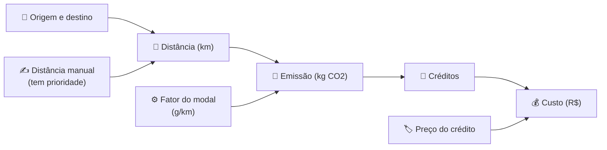
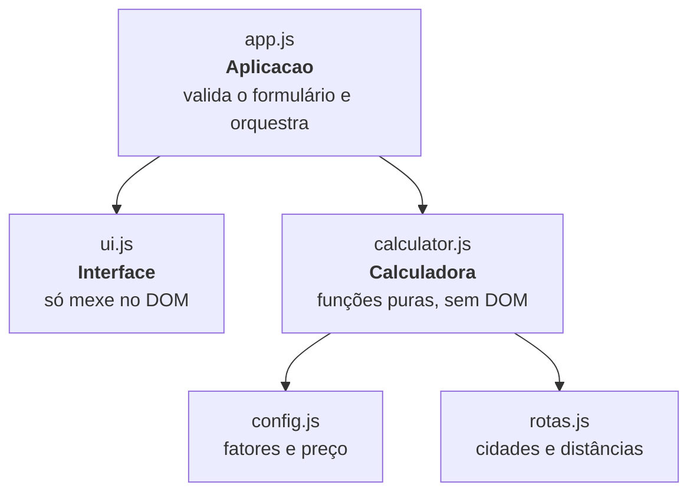

<div align="center">

<h1>🌱 EcoTrip</h1>

<p><b>Descubra quanto CO₂ a sua viagem emite e quanto custa compensá-la.</b></p>

<p>
  
  
  
</p>
<p>
  
  
  
</p>

<h3>
  <a href="https://gtvnv.github.io/EcoTrip/">🌐 Abrir o site</a>
  &nbsp;·&nbsp;
  <a href="#-como-o-cálculo-funciona">🧮 Cálculo</a>
  &nbsp;·&nbsp;
  <a href="#-como-rodar-e-testar">🧪 Testes</a>
</h3>

</div>

> [!NOTE]
> A URL do site é a esperada após o primeiro deploy no GitHub Pages. Ela só funciona depois que o workflow rodar com sucesso.

---

## 📋 Índice

[Visão geral](#-visão-geral) ·
[Como o cálculo funciona](#-como-o-cálculo-funciona) ·
[Modais e fatores](#-modais-e-fatores-de-emissão) ·
[Arquitetura](#-arquitetura) ·
[Estrutura](#-estrutura-do-projeto) ·
[Como rodar e testar](#-como-rodar-e-testar) ·
[Ordem de construção](#-ordem-de-construção) ·
[Prompt](#-prompt-que-funcionou-bem) ·
[Ideias futuras](#-ideias-futuras)

## ✨ Visão geral

A EcoTrip calcula a emissão de CO2 de uma viagem e o custo estimado para compensá-la com créditos de carbono. Ela compara quatro modais: bicicleta, carro, ônibus e caminhão. É feita só com HTML, CSS e JavaScript puros, sem bibliotecas de terceiros na página.

**Como usar:**

1. Digite a origem e escolha uma cidade na lista de sugestões.
2. Digite o destino e escolha uma cidade na lista.
3. Se a rota não existir na base, informe a distância manual em km.
4. Selecione o modal de transporte.
5. Clique em calcular e leia o resultado, a comparação entre modais e os créditos.

### O que você vê na tela

| 📍 Resultado | 📊 Comparação | 🌳 Créditos |
|:--|:--|:--|
| Distância, modal e emissão em kg de CO2 | Os quatro modais lado a lado, em barras, do que menos emite ao que mais emite | Créditos de carbono e custo estimado para compensar |

## 🧮 Como o cálculo funciona

Os valores vêm de `config.js` (fatores de emissão e preço do crédito) e de `rotas.js` (distâncias).



| # | Etapa | Fórmula |
|:-:|-------|---------|
| 1 | **Distância (km)** | `obterDistancia(origem, destino)` na base de rotas. A ordem das cidades não importa. Uma distância manual válida (maior que 0 e até 20.000 km) tem prioridade. |
| 2 | **Emissão (kg de CO2)** | `distância (km) × fator (g/km) ÷ 1000` |
| 3 | **Créditos de carbono** | `emissão (kg) ÷ 1000` (1 crédito compensa 1 tonelada de CO2) |
| 4 | **Custo de compensação (R$)** | `créditos × preço do crédito` |

### 🔢 Exemplo numérico

Rota **São Paulo → Rio de Janeiro** de **carro**:

| Etapa | Conta | Resultado |
|-------|-------|----------:|
| Distância | valor da base de rotas | **430 km** |
| Emissão | 430 × 170 ÷ 1000 | **73,10 kg de CO2** |
| Créditos | 73,10 ÷ 1000 | **0,0731 crédito** |
| Custo | 0,0731 × 50,00 | **R$ 3,66** (3,655 arredondado) |

> [!NOTE]
> Esses valores foram conferidos executando `calculator.js` e `config.js` em Node. A tela mostra a emissão com 2 casas, os créditos com 4 e o custo com 2, com arredondamento meio para cima.

> [!WARNING]
> Todos os valores são estimativas, apenas para fins informativos. Fatores de emissão, distâncias e preço do crédito são valores de referência aproximados e variam conforme a fonte. Confira-os antes de usar em relatórios.

## 🚗 Modais e fatores de emissão

| Modal | Fator (g CO2/km) | Comparado ao carro |
|-------|-----------------:|-------------------:|
| 🚲 Bicicleta | 0 | sem emissão |
| 🚌 Ônibus | 100 | 41% menos |
| 🚗 Carro | 170 | referência |
| 🚚 Caminhão | 900 | 5,3 vezes mais |

Preço do crédito: **R$ 50,00 por tonelada de CO2**. Os fatores e o preço ficam em `config.js`, com unidade e fonte comentadas em cada valor.

## 🏛️ Arquitetura

O código separa cálculo, tela e orquestração. A `Calculadora` não conhece o DOM, o que a torna fácil de testar.



## 🗂️ Estrutura do projeto

```text
EcoTrip/
├── index.html        # estrutura semântica da página
├── style.css         # estilo, com a paleta em variáveis CSS
├── rotas.js          # Base_de_Rotas: cidades e distâncias
├── config.js         # fatores de emissão e preço do crédito
├── calculator.js     # Calculadora: funções puras, sem DOM
├── ui.js             # Interface: tudo que mexe no DOM
├── app.js            # Aplicacao: conecta Calculadora e Interface
├── tests/            # testes de propriedade, unitários e de fumaça
└── .github/workflows/deploy.yml   # deploy no GitHub Pages
```

## ▶️ Como rodar e testar

**Usar a página:** abra o `index.html` no navegador. Não há build nem servidor.

**Rodar os testes** (precisa do Node.js):

```bash
npm install
npm test
```

<details>
<summary>🧪 O que os testes cobrem</summary>

- **13 propriedades** com `fast-check`: emissão, validação de entradas e da configuração, distâncias, créditos e custo, formatação, comparação de modais e autocomplete.
- **Testes unitários** da Calculadora e da Interface (com `jsdom`).
- **Testes de fumaça** da estrutura do HTML, do CSS (cores só em variáveis, classes BEM) e da ausência de chaves de API.

Eles são só de desenvolvimento e não vão para o site publicado.

</details>

## 🏗️ Ordem de construção

1. `index.html`
2. `style.css`
3. Base de rotas (`rotas.js`) e `config.js`
4. `calculator.js`
5. `ui.js`
6. `app.js`

## 💡 Prompt que funcionou bem

Usado na etapa 4 (`calculator.js`):

```text
Crie calculator.js com funções puras, sem acessar o DOM. A distância deve vir
de uma única função (obterDistancia), para eu poder trocá-la depois por uma API
de mapas. Fatores e preço devem vir só de config.js. Entradas inválidas devem
lançar um erro que identifique o parâmetro.
```

## 🚀 Ideias futuras

1. Mais cidades na base de rotas.
2. Destaque do modal selecionado na comparação.
3. Soma de várias viagens.
4. API de mapas para obter a distância.
5. Back-end em Python.

---

<div align="center">
<sub>Feito com 💚 em HTML, CSS e JavaScript puros.</sub>
</div>